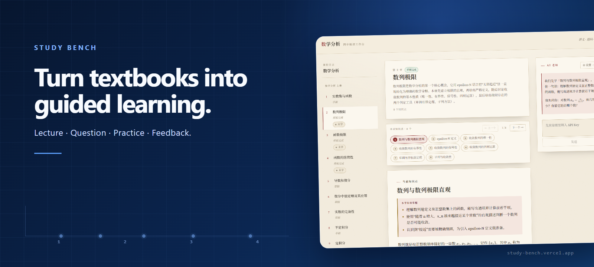
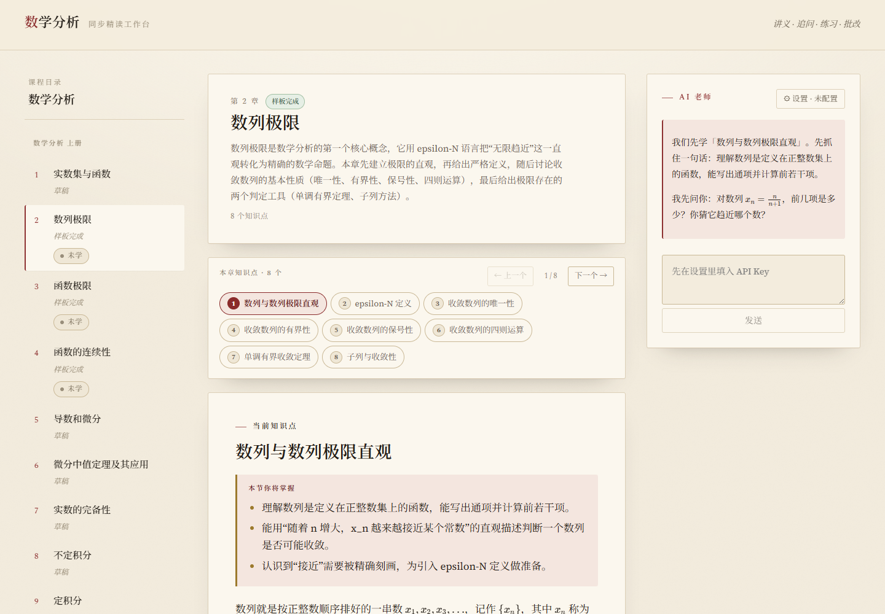
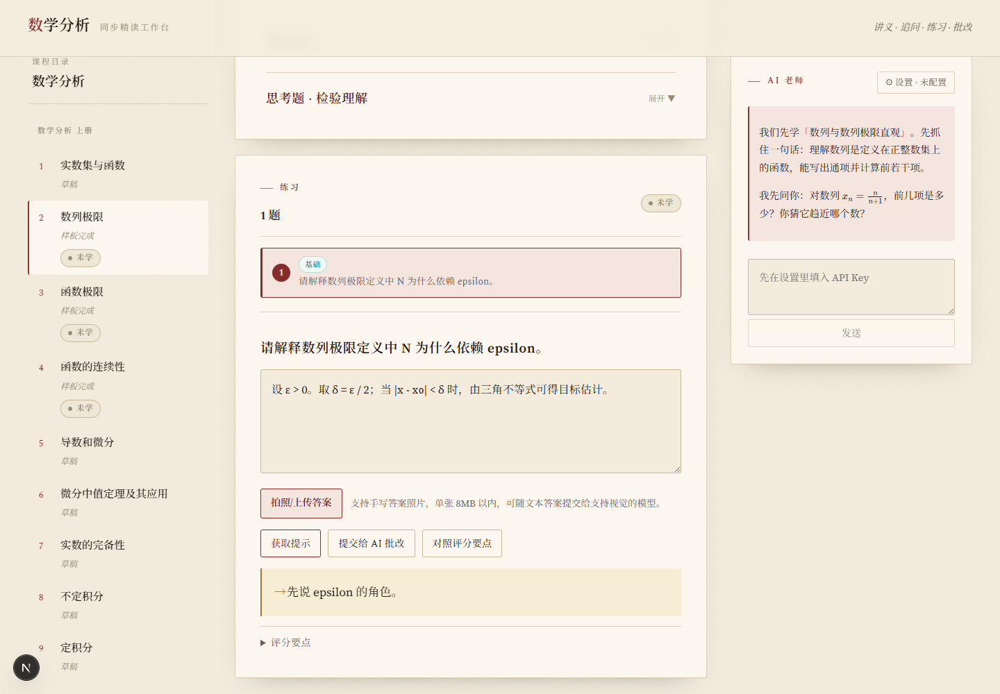
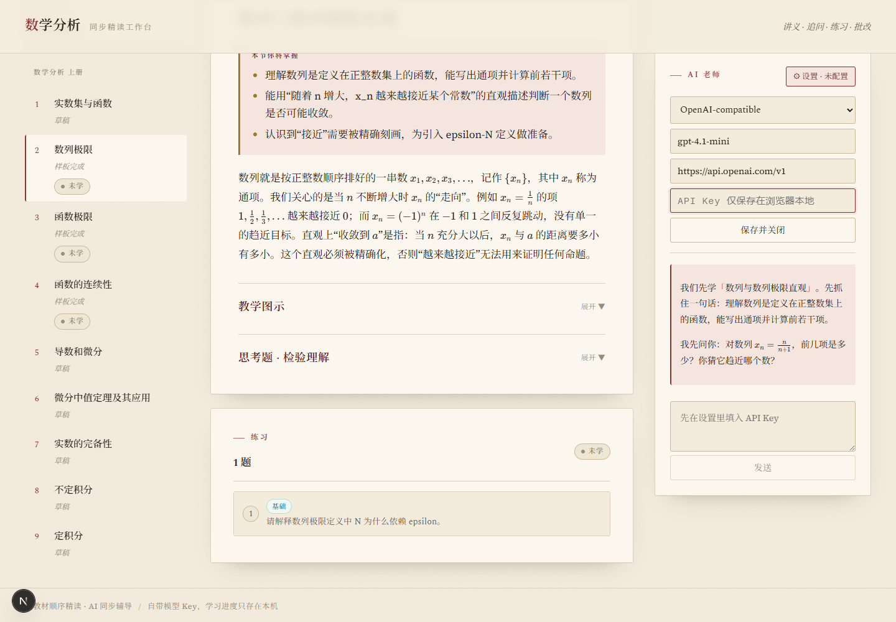
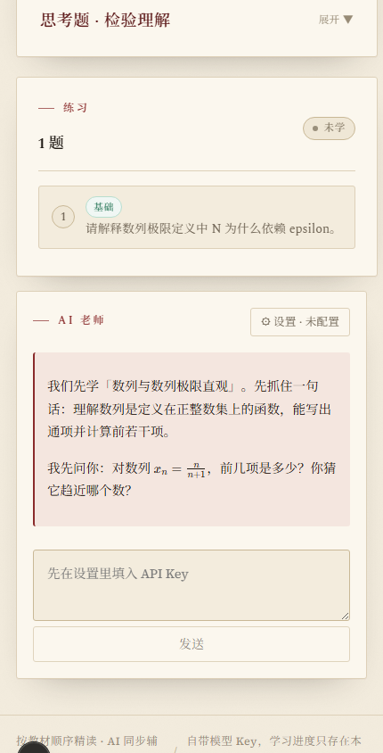

# Study Bench



**English** · [简体中文](./README.zh-CN.md)

[](#validation)
[](https://nextjs.org/)
[](https://www.typescriptlang.org/)
[](./LICENSE)

Study Bench is an AI learning workbench for moving through a textbook in order: read a focused lecture, answer guided questions, practise, receive feedback, and keep a local record of mastery.

**[Open the live demo](https://study-bench.vercel.app)**

## Learn in a complete loop

Most study tools separate reading, problem solving, and AI chat. Study Bench keeps them around the same knowledge point, so the tutor knows what you are learning and practice follows the lecture that introduced it.

```text
Textbook order → Lecture → Socratic questions → Practice → AI feedback → Local mastery
```

The current product is a Math Analysis workbench in Chinese. Course navigation follows the two-volume, 22-chapter textbook outline, while each learning screen brings the lecture, questions, exercises, and tutor into one workspace.

## What you can do

- Navigate two volumes, chapters, and knowledge points in textbook order.
- Read structured explanations, goals, definitions, theorems, proof ideas, and formulas rendered with KaTeX.
- Expand teaching diagrams and Socratic questions when you need another way into a concept.
- Choose exercises, reveal layered hints, and inspect grading criteria.
- Submit a typed solution, answer images up to 8 MB each, or both for AI review.
- Configure an OpenAI-compatible, DeepSeek, Xiaomi MiMo, or Gemini preset, then override the model and base URL when needed.
- Keep attempt history and mastery state in the browser with no account or application database.

## The learning workflow

1. Select a volume and chapter from the course directory.
2. Move through the chapter's knowledge points in order.
3. Read the lecture and render inline or display mathematics with KaTeX.
4. Open diagrams and Socratic prompts to test understanding.
5. Pick an exercise, write or photograph a solution, and request hints only when needed.
6. Send the answer to the configured model for a score, targeted feedback, missing key points, and a mastery suggestion.
7. Revisit the chapter using the mastery markers stored locally in the browser.

## Screenshots

### Learning workbench



### Exercise and hint review



### AI tutor settings



### Mobile learning view



## AI tutor and privacy model

Study Bench is bring-your-own-key: it ships without an API key. Provider, model, base URL, and API key settings are saved in the browser's `localStorage`. Mastery state, answer text, attempt metadata, and returned feedback are also stored locally; there is no application database or account system.

When you ask the tutor or submit an answer, the browser sends the selected settings—including the API key—and the relevant learning context to a Next.js server route. That route forwards the request to the configured model provider. Answer images are converted to request data in the browser and forwarded for grading; the app does not add them to the local progress record.

This means the deployment operator and model provider are part of the trust boundary. Review their policies, use a restricted key, and prefer your own deployment for credentials you do not want to send through a third-party-hosted demo. Never commit keys to the repository.

## Course content

Course material is maintained as structured JSON under `content/courses/math-analysis/`, separate from the UI. The registry mirrors a two-volume, 22-chapter Math Analysis sequence.

- **Sample-ready:** sequence limits, function limits, and continuity.
- **Current default chapter:** sequence limits, with 8 knowledge points, 8 exercises, and 6 teaching diagrams.
- **Draft coverage:** the other chapter entries and their structured material remain explicitly marked as draft rather than presented as complete.

The repository contains the structured learning material, not the source textbook files. Textbook PDFs are intentionally excluded by `.gitignore` and are not committed or distributed here.

## Quick start

```bash
git clone https://github.com/Xiaotian69/study-bench.git
cd study-bench
npm ci
npm run dev
```

Open [http://localhost:3000](http://localhost:3000). You can explore the course without a model key; AI chat and answer grading require a compatible provider configuration.

## Validation

Run the complete content, tutor-contract, API-wiring, vision-grading, progress-state, mastery-state, and production-build checks:

```bash
npm run validate:all
```

The focused checks are also available as individual `validate:*` scripts in [`package.json`](./package.json).

## Project structure

```text
app/                              Next.js App Router pages and server routes
components/course/                course, exercise, diagram, and tutor UI
content/courses/math-analysis/    two-volume structured course JSON
lib/ai/                           tutor contracts, provider runtime, and clients
lib/course/                       course registry, loading, and selectors
lib/progress/                     browser settings and local mastery records
scripts/                          content, integration, state, and build validation
docs/assets/                      README screenshots and deterministic artwork
```

## Roadmap

- Bring the remaining draft chapters to sample-ready depth.
- Add stronger automated browser and responsive-layout regression coverage.
- Explore optional progress export or sync without changing the local-first default.

Roadmap items are future work and are not available in the current product.

## License

Released under the [MIT License](./LICENSE). Course excerpts and adapted exercises may have separate source-rights considerations; textbook PDFs are not part of this repository.
